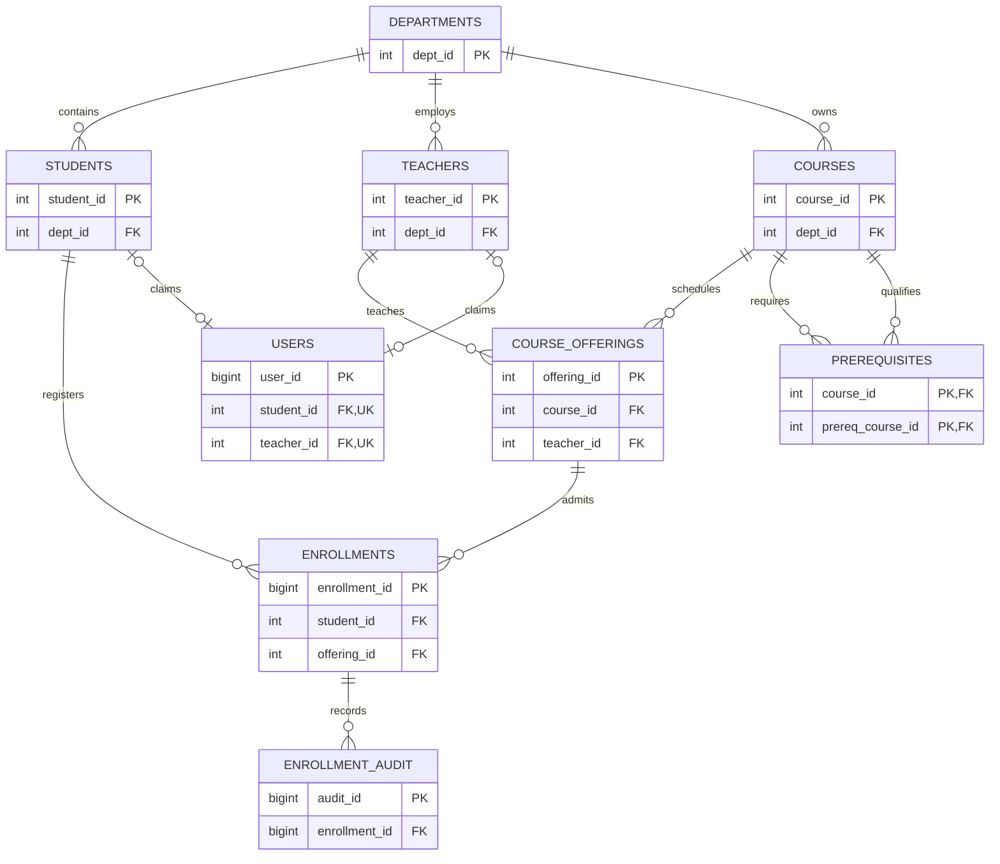

# CourseLink entity relationships

Each academic identity can claim at most one account. A student account links to exactly one student, a teacher account to exactly one teacher, and an admin has both foreign keys null. The role check imposes that additional exclusive relationship.
